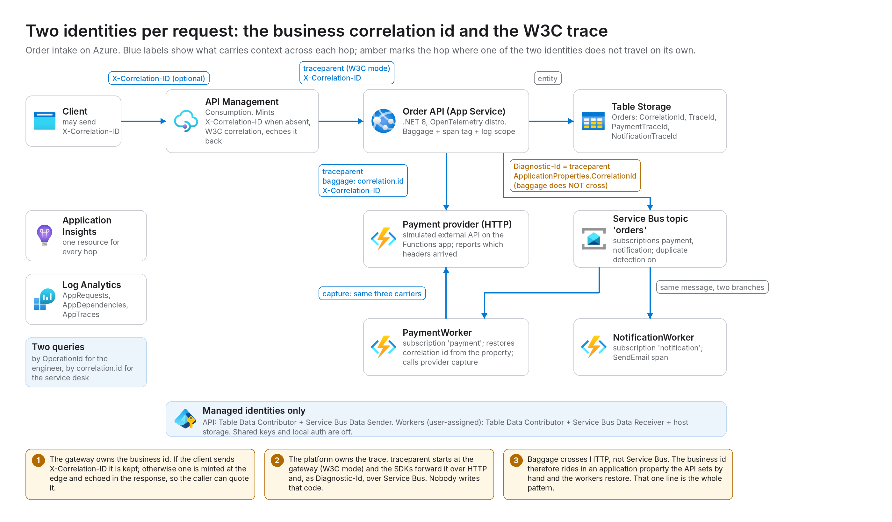
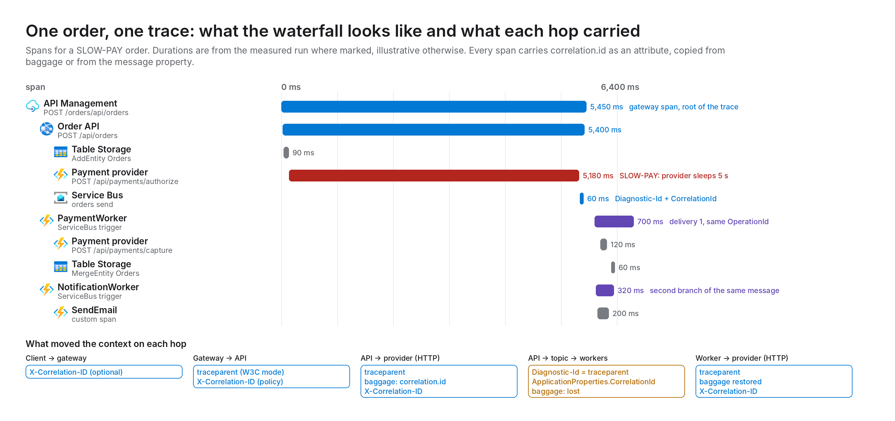
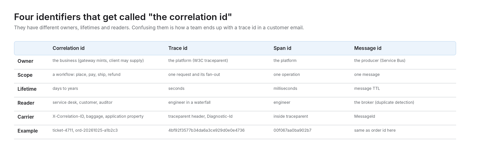

# correlation-tracing-azure

Companion repo for the Cloud Perspectives post *Correlation IDs and OpenTelemetry on Azure: One Request, Two Identities*.

A request carries two identities. The **trace ID** is the platform's (W3C `traceparent`), lives for one request and is read by an engineer in a waterfall. The **correlation ID** is the business's, lives for the whole workflow and is what the service desk searches for. This repo builds an order flow that carries both across API Management, an API on App Service, a payment provider over HTTP, a Service Bus topic and two Function workers, and measures where each survives.



## What runs

| Piece | Service | Role in the story |
|---|---|---|
| `infra/modules/apim.bicep` | API Management (Consumption) | Keeps the caller's `X-Correlation-ID` or mints `gw-<12 hex>`, echoes it back, W3C correlation mode so the gateway span is the trace root |
| `src/OrderApi` | App Service (Linux B1), .NET 8, Azure Monitor OpenTelemetry distro | Middleware puts the id in baggage, on the span and in the log scope; processor tags every span with `correlation.id`; writes Table Storage, calls the provider, publishes to the topic with `ApplicationProperties.CorrelationId` |
| `src/Workers` | Functions Flex Consumption, .NET 8 isolated, OpenTelemetry mode | `PaymentProvider` (HTTP, simulated external, reports which carriers arrived), `PaymentWorker` and `NotificationWorker` (topic subscriptions, restore the id from the property) |
| Messaging | Service Bus Standard, topic `orders`, subscriptions `payment` and `notification` | Diagnostic-Id carries the trace; baggage does not cross |
| Data | Table Storage `Orders` | Stores `CorrelationId`, `TraceId`, `PaymentTraceId`, `NotificationTraceId` so the console can show whether the workers ran in the same trace |
| Ops | Log Analytics + workspace-based Application Insights | One resource for every hop; queries in `measure/queries.kql` |



## Run it

```powershell
azd auth login
azd env new correlation
azd env set AZURE_LOCATION swedencentral
azd up
python .\measure\drive.py all
```

Sampling experiment:

```powershell
azd env set TRACING_SAMPLING_RATIO 0.1
azd provision
python .\measure\drive.py burst 100          # writes measure/burst-trace-ids.txt for query 6
```

Tear down with `azd down --purge`. Full steps, screenshot list and known gaps: [docs/walkthrough.md](docs/walkthrough.md). Draft post: [docs/blog-correlation-tracing-azure.md](docs/blog-correlation-tracing-azure.md).

## Scenarios

| SKU / flag | What happens | What to look at |
|---|---|---|
| `BOOK-1` | happy path | both workers report the API's trace id |
| `X-Correlation-ID: ticket-123` on the request | client-supplied business id | gateway keeps it, every span and log line carries it (query 2) |
| `SLOW-PAY` | provider sleeps 5 s on authorize | query 5: the dependency span explains the slow API span |
| `FAIL-ONCE` | payment worker throws on delivery 1 | query 4: two deliveries, one trace |
| `DECLINE` | provider answers 402 | order ends Declined, no message published |
| `burst 100` with ratio 0.1 | head sampling | query 6: complete vs partial traces |

## The four identifiers



## Repo layout

```
azure.yaml                 azd services (api -> appservice, workers -> function) and the postprovision hook
infra/                     main.bicep + modules (apim, roles)
src/OrderApi/              ASP.NET Core minimal API + wwwroot/index.html console; Correlation.cs
src/Workers/               Functions isolated worker; Correlation.cs (duplicated on purpose)
scripts/                   PowerShell 5.1-safe hook
measure/                   drive.py (stdlib only), queries.kql
images/                    make_diagrams.py, icons/ (official Azure icons), PNG output
docs/                      blog draft, walkthrough
```

## Notes

- The payment provider endpoint is anonymous on purpose: it stands in for an external system and the sample wants to show plain headers arriving. Do not copy that part.
- No `ApplicationInsightsAgent_EXTENSION_VERSION` on the App Service: the app ships the OpenTelemetry distro and the codeless agent would double-instrument it.
- Icons come from Microsoft's [Azure architecture icons](https://learn.microsoft.com/azure/architecture/icons/) and are used under Microsoft's terms for that set.

## License

MIT for the code in this repo. Azure icons remain Microsoft's.
